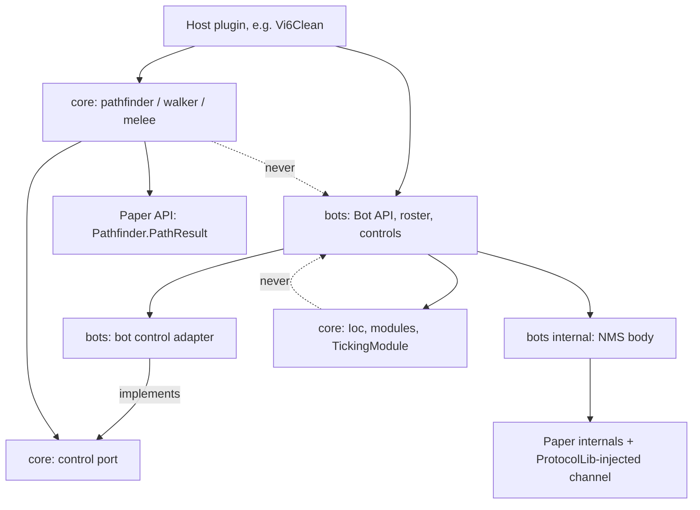
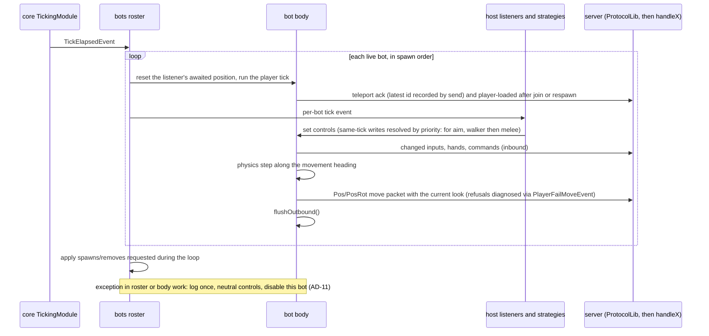

# Architecture Spine: NekotineBots in NekotineCore + Vi6Clean bot integration

## Design Paradigm

**Layered library, ports and adapters.** Each layer depends only on layers below it. Movement and fighting are **strategies behind ports**: a pathfinder returns a `PathResult`, and a walker or melee controller drives a body through a **control port**. Each body type supplies its own adapter for that port.

| Layer (top depends on bottom) | Lives in | Knows |
| --- | --- | --- |
| Host behaviour ("brains"), host commands, host test hooks | host plugin (Vi6: `fr.nekotine.vi6clean.bot`) | its own game, `core` strategies, the `bots` API |
| Strategies: pathfinders, walkers, melee controllers | NekotineCore `core` | Paper API only |
| Ports: `PathResult` (Paper), the control port | NekotineCore `core` | Paper API only |
| Bot API, roster, low-level controls, bot control adapter | NekotineCore `bots`, public packages | Bukkit, Paper and `core` types in signatures |
| Bot body: fake connection, `ServerPlayer`, acks, physics, flush | NekotineCore `bots`, internal package | NMS |



## Inherited Invariants

These come from the spec-bots constraints and bind here unchanged:
- Bots are real fake players: `ServerPlayer` on a fake `Connection` backed by an `EmbeddedChannel`, joined through `PlayerList.placeNewPlayer`. Every input reaches the game through a real `handleX` call fed by a real serverbound packet, written inbound into the channel.
- The body is written from scratch: reference plugins are inspiration only, and any verbatim snippet keeps its MIT notice. Shaded MIT dependencies (for example Pathetic) ship their notice.
- Java, not Kotlin. One Minecraft version per release for `bots`, with no multi-version layer. Minimal reflection.
- Sized for 2v2 to 3v3: lobby fill uses 1-5 bots, an unattended run 4 bots typically and 6 at most.
- Baritone does not run server-side. Network-client bots are rejected.
- Scripted-bot tests of a tool or phase give the same result on 3 consecutive runs. A soak test passes when the game reaches a result with no exception in the log.

## Invariants & Rules

### AD-1: NekotineCore becomes a multi-module repository and owns the test harness [ADOPTED]

- **Binds:** CAP-7, all
- **Prevents:** Core and bot code drifting to different commits, nested or duplicated submodules, and NMS pinning every plugin that only uses Core.
- **Rule:**
  - The NekotineCore repository holds a `core` module (Paper API only, no paperweight) and a `bots` module (paperweight userdev, NMS), which depends on `core`. `core` never depends on `bots`.
  - A host consumes both through its one NekotineCore submodule plus `includeBuild`.
  - paper-junit-server is a submodule of NekotineCore. Hosts reach it through NekotineCore (Vi6Clean → NekotineCore → paper-junit-server) and keep no copy of their own.
  - Only `bots` is tied to one Minecraft version. Its dev bundle matches the host's dev bundle and the server it runs on. `core` stays unpinned.

### AD-2: Only the final plugin shades

- **Binds:** all
- **Prevents:** two copies of `fr.nekotine.core` in one plugin jar, and relocation clashes between libraries.
- **Rule:**
  - `core` and `bots` publish plain jars and never run shadow.
  - Each host plugin shades exactly one copy of each library module it uses, plus its third-party runtime dependencies, and does any relocation itself. CommandAPI shading and relocation therefore move from Core to the host.
  - This relies on Paper-plugin classloader isolation. Every host is a Paper plugin, no host uses `join-classpath` towards another Nekotine host, and no `fr.nekotine.core` type crosses between plugins.

### AD-3: The bot API speaks Bukkit; NMS stays in one internal package and is checked at boot [ADOPTED]

- **Binds:** CAP-7
- **Prevents:** hosts writing NMS code, NMS spreading through the module, and a Paper update silently breaking bots.
- **Rule:**
  - Public `bots` types expose only Bukkit, Paper and `core` types.
  - NMS and reflection are confined to one internal package of about 25 NMS types across 2-3 files.
  - When the host enables, it forces the roster module to load, which runs a self-test of every NMS or reflective accessor. Core's `ModuleManager` loads modules lazily and only logs constructor errors, so this has to be forced.
  - If the self-test fails, the module logs a loud error and disables itself. Every bot API call then reports "bots unavailable", and the host keeps running for humans.

### AD-4: The low-level control surface [ADOPTED]

- **Binds:** CAP-1, CAP-2, CAP-3, CAP-8
- **Prevents:** shortcuts that skip real handlers (direct game-mode, slot or position calls, fabricated events), and each host inventing its own inputs.
- **Rule:** A bot is controlled only through these groups.

  | Group | Controls |
  | --- | --- |
  | Lifecycle | spawn (name, location, wipe flags; see AD-10), remove, list, `Player` handle |
  | Movement | movement heading (yaw), forward/back, strafe, jump, sneak, sprint |
  | Aim | look (yaw/pitch) |
  | Hands | hotbar slot, use item, use item on block + face, left-click/start-break, attack entity, interact entity, swap hands |
  | Other | send command (a real chat-command packet through `handleChatCommand`), respawn |

  - Every control becomes a real serverbound packet. Packets are sent on change, the way a client sends them.
  - Movement keys and sneak/sprint persist until changed. Look and slot persist until changed. Hands actions and commands fire once, in the next apply step.
  - Position changes only through the body's server-physics step from the movement group. That step runs along the **movement heading**, not along the look. The result goes through `handleMovePlayer` as `Pos`/`PosRot` carrying the current look. A real client cannot separate heading from look; this is accepted because anti-cheat is a non-goal. Heading defaults to the look yaw.
  - There is no `setPosition`, teleport or dialog control. Inventory clicks and drop are added only when a consumer needs them.

### AD-5: Host logic acts in the per-bot tick event; same-tick writes follow a fixed priority [ADOPTED, amended 2026-11-05]

- **Binds:** CAP-3, CAP-4, CAP-5, CAP-8
- **Prevents:** inputs landing a tick late, timing that depends on listener order, and two strategies jittering a bot by overwriting each other's controls.
- **Amendment (2026-11-05):** the user replaced the original one-owner-per-group rule (claims, plus a loud failure on a non-owner write) with the priority order below. Ownership forced every strategy to claim and release groups, and broke writers that had never claimed anything.
- **Rule:**
  - Driven by Core's `TickingModule` `TickElapsedEvent`, the roster fires one Bukkit event per live bot on the main thread, in spawn order. It fires after pending acks are sent and before inputs are applied and physics steps.
  - Controls set during the event apply that same tick. Controls set anywhere else apply on the bot's next tick.
  - Strategies (walker, melee) run only from inside this event, never from their own `TickElapsedEvent` listener.
  - There is no ownership. Any writer (brain, walker, melee controller) may set any control group (movement, aim, hands), and no write fails.
  - When several writers set the same group on a bot in one tick, a fixed priority order decides which write applies, whatever order the listeners ran in. A writer that sets nothing in a tick leaves the lower-priority write in place.
  - For aim (head direction), the walker's write applies first and the melee controller's write overrides it. A bot therefore looks along its path, except while melee is aiming at a target. The full order for each group is fixed by the control-port story.

### AD-6: The shared path contract is Paper's `PathResult` [ADOPTED]

- **Binds:** CAP-4, CAP-7
- **Prevents:** a walker that only works with one pathfinder, NMS path types leaking into `core`, and two walkers disagreeing on path progress.
- **Rule:**
  - Pathfinders return `com.destroystokyo.paper.entity.Pathfinder.PathResult`.
  - Walkers accept any `PathResult`, including a vanilla mob's. They treat it as read-only and keep their own progress cursor.
  - Walkers infer each move (step, jump, drop, door) from point geometry and the world. A pathfinder may implement a Nekotine sub-interface with per-point hints; a walker may read it but must work without it.

### AD-7: The pathfinder is one port with swappable implementations [ADOPTED]

- **Binds:** CAP-4
- **Prevents:** game rules (such as Vi6's entrance and exit rules) hard-coded in a pathfinder, callers depending on one algorithm, and host rules running on the wrong thread.
- **Rule:**
  - `core` defines one pathfinder interface. Implementations (own A*, Pathetic adapter, per-map graph, vanilla via Paper's mob pathfinder) are interchangeable without changing callers.
  - The caller supplies the passability and cost rule for each search.
  - An implementation that searches off the main thread reads the world only through a snapshot it takes on the main thread. It calls the caller's rule only on that snapshot, and it completes the caller's result on the main thread.

### AD-8: Walkers and melee controllers are selectable strategies that drive the control port [ADOPTED]

- **Binds:** CAP-4, CAP-7, CAP-8
- **Prevents:** a bot-only walker or fighter that mobs can't reuse, and a strategy that moves a body other than through its inputs.
- **Rule:**
  - `core` holds the walker and melee-controller interfaces and implementations: a vanilla-like walker now, a reinforcement-learning walker later. A caller picks one per use, and swapping it doesn't change the caller.
  - A strategy reads and drives its body only through the control port. The port mirrors AD-4's movement, aim and hands groups and exposes location, velocity, on-ground and look as world-space values.
  - Melee positioning (a caller-set standoff distance and a positioning policy, such as close in, cut retreat, or keep distance and strafe) is done by the walker following a moving goal. In Vi6, PvP is one-sided: guards close in and cut off the thief's retreat, and thieves flee.
  - `bots` ships the bot adapter, which maps the port 1:1 onto AD-4. A mob adapter translates the same port.

### AD-9: Bot work runs on the main thread

- **Binds:** all
- **Prevents:** races on the roster and on NMS state, and inbound channel writes from untested threads.
- **Rule:**
  - Controls, the tick event, roster changes, every `writeInbound` and every flush happen on the main thread.
  - The bot connection's `send()` can be called from any thread, so it only records state thread-safely, for example a pending teleport id. It never writes inbound and never sends an ack.
  - Only a pathfinder search may run elsewhere (AD-7).

### AD-10: The roster is the single owner of bot lifecycles; bots are ephemeral [ADOPTED]

- **Binds:** CAP-1, CAP-5
- **Prevents:** bots outliving their host, leftover players or stale data after a run, two removal paths, and a bot that is changed while it is being ticked.
- **Rule:**
  - The roster is an `IPluginModule` in `bots`, resolved through `Ioc`.
  - A bot joins through `placeNewPlayer` with a stable offline UUID derived from its name (`UUIDUtil.createOfflinePlayerUUID`).
  - Every exit goes through one path: flush, close the connection, normal quit (`PlayerQuitEvent` fires), drop from the roster, then apply the wipe flags. Exits include roster removal, unload, kick and a server-side disconnect.
  - Wipe flags are chosen at spawn and both default to on. "Reset state" deletes `world/players/data/<uuid>.dat`. "Reset statistics" deletes the stats and advancements files. The wipe runs after the quit save completes.
  - Spawn and remove requests made during the roster's tick loop take effect at the end of that loop.
  - `unload()` removes every bot. Nothing restores a bot across a restart or `/reload`. Each host has its own roster.

### AD-11: The library guards its own work; a failing bot logs once and disables itself [ADOPTED]

- **Binds:** CAP-5, CAP-7
- **Prevents:** a broken bot logging 20 stack traces a second, a bot that silently stops acting, and game concepts leaking into the library.
- **Rule:**
  - The `bots` module guards its own per-bot tick work. On an exception it logs once (the bot's name plus the stack trace), sets the bot's controls to neutral, and stops ticking it. The bot stays connected and the roster reports it as failed.
  - Exceptions thrown by host listeners belong to the host. Paper logs them, and the host guards its own listeners.
  - Library logs carry bot context only, never host concepts such as a Vi6 phase. Game context (phase, team) is added by the host when it logs its own behaviour or tests.

### AD-12: Vi6 bot behaviour plays by human rules [ADOPTED]

- **Binds:** CAP-2, CAP-5
- **Prevents:** bots reaching results through shortcuts a human can't take, which would make bot-driven tests prove nothing.
- **Rule:**
  - Vi6 bot behaviour reads game state only through Vi6's public API and acts only through bot controls, including sending the same commands a player can send (for example team and ready).
  - The team requested when a bot is added is an intent handed to its brain at spawn. Only the brain carries it out, through those commands.
  - No Vi6 game-logic file checks whether a player is a bot. Vi6 brains guard their own tick listener: they catch, log with bot and game context, and stop that brain.

### AD-13: Bot tests and Vi6 tests stay separate [ADOPTED]

- **Binds:** CAP-5, CAP-7
- **Prevents:** a Vi6 failure read as a bot defect and vice versa, and test hooks coupling the two codebases.
- **Rule:**
  - Library tests run in the NekotineCore repository, through a tiny host plugin on paper-junit-server (AD-1), and never depend on Vi6.
  - Vi6 integration tests test Vi6 and use bots only as a driver.
  - Vi6's test hooks (forcing teams and phase, short timers, resetting between tests) belong to Vi6, depend only on the bot API, and are never called by brains (AD-12).

### AD-14: Hosts own operator commands

- **Binds:** CAP-1, CAP-5
- **Prevents:** a library command and a host command both claiming the same bots or the same command name.
- **Rule:** `bots` ships an API and no command. Each host registers its own. In Vi6 these are: add N bots with a team intent, list, remove, and start one unattended run.

## Consistency Conventions

| Concern | Convention |
| --- | --- |
| Packages | `bots`: `fr.nekotine.core.bot` (public), `fr.nekotine.core.bot.internal` (NMS). `core`: `fr.nekotine.core.navigation` (pathfinder, walkers, control port), `fr.nekotine.core.combat` (melee). Vi6: `fr.nekotine.vi6clean.bot`. |
| Registration | Library singletons are `IPluginModule`s found by Core's reflective `setupModules()` and resolved with `Ioc.resolve(...)`. The roster is resolved eagerly at host enable (AD-3). |
| Ticking | Library per-tick work hangs off `TickElapsedEvent`. Strategies tick only inside the per-bot tick event. |
| Logging | Bot log lines start with the bot's name. One stack trace per failure (AD-11). |
| Coordinates | Points cross module boundaries as Bukkit `Location`. NMS `BlockPos`/`Vec3` never leave `bot.internal`. |
| Language | French or English in code, logs and Javadoc. Existing text is not translated. |
| Commits | Conventional Commits. A NekotineCore change ships with its gitlink commit in the same Vi6Clean PR. |

## Stack

| Name | Version |
| --- | --- |
| Java | 25 |
| Gradle (wrapper) | 9.4.1 (Paper 26.3 needs ≥ 9.7.1) |
| Paper dev bundle / API (Vi6, and `bots` must match) | 26.2.build.65-beta |
| Paper API (NekotineCore `core` today) | 26.2.build.31-alpha |
| paperweight userdev | 2.0.0-beta.21 (Paper 26.3 needs 2.0.0-beta.24) |
| ProtocolLib (server) | 5.5.0-SNAPSHOT-2d3b3e3 dev build, the one the spike verified; no released 26.x build |
| ProtocolLib (compile) | 5.4.0 |
| CommandAPI | 11.2.0 shaded by Core today; 11.2.1-SNAPSHOT locked in Vi6; 12.x for 26.2/26.3 |
| Shadow (hosts only) | 9.4.3 resolved from `9.4.+` |
| Pathetic (optional pathfinder implementation) | de.bsommerfeld.pathetic:engine 5.5.2 |
| paper-junit-server | NekotineCore submodule, working tree |

## Structural Seed

```text
NekotineCore/                 # one repo; one submodule in each host
  core/                       # Paper API only; existing Core code moves here
    src/main/java/fr/nekotine/core/
      navigation/             # pathfinder port + impls, PathResult impl, walkers, control port
      combat/                 # melee controller strategies
  bots/                       # paperweight userdev, depends on :core
    src/main/java/fr/nekotine/core/bot/
      internal/               # NMS body, fake connection, self-test
  bots-test-host/             # tiny host plugin for the library's own integration tests
  paper-junit-server/         # submodule (moved from Vi6Clean)
Vi6Clean/
  src/main/java/fr/nekotine/vi6clean/bot/   # brains, commands, wiring to the Vi6 public API
  src/integrationTest/java/...              # Vi6 tests, bots as driver
```

One bot tick:



### Environments and operations

- **No new deployable.** The libraries are shaded into Vi6Clean's jar, which reaches the dev server through `plugins/update/`.
- **Integration suite.** It boots from `test-bundle/`, which needs `spawn-protection=0` (it has 16 today) so non-op bots can click near spawn. `max-players=20` is enough.
- **Production.** The same jar runs there. Bots appear only when an operator adds them.
- **A Paper update that breaks NMS** leaves Vi6 running without bots (AD-3).

## Capability → Architecture Map

| Capability | Lives in | Governed by |
| --- | --- | --- |
| CAP-1 Runtime bot control | `bots` roster + Vi6 commands | AD-10, AD-14 |
| CAP-2 Player parity (dialogs now out; teams through commands) | `bots` body + Vi6 normal join path and commands | AD-4, AD-12 |
| CAP-3 Tool use | `bots` controls | AD-4, AD-5 |
| CAP-4 Autonomous movement | `core` navigation + bot adapter + Vi6 brains | AD-6, AD-7, AD-8 |
| CAP-5 Unattended run | Vi6 brains, commands, test hooks | AD-10, AD-11, AD-12, AD-13, AD-14 |
| CAP-7 Reusable bots | `bots` public API, `core` strategies | AD-1, AD-2, AD-3, AD-13 |
| CAP-8 Melee | `core` combat + walker + bot adapter | AD-5, AD-8 |

## Deferred

- **Exact control-port method names:** set by the first walker story; AD-4, AD-5 and AD-8 fix its groups and semantics.
- **Mob control adapter:** waits for the first mob consumer.
- **Reinforcement-learning walker:** waits for the vanilla-like walker; AD-8 lets it slot in.
- **Pathfinder algorithm for Vi6:** chosen by the navigation story; AD-7 keeps it swappable.
- **Dialogs:** ignored. They may return later as a hand-made custom click.
- **F3 path debug rendering through ProtocolLib debug subscriptions:** out of scope until the user brings it back.
- **How Vi6 exposes its test hooks (commands vs public methods):** settled by the Vi6 test stories; AD-13 bounds them.
- **Build migration details** (Gradle coordinates for `core`/`bots`, replacing Vi6's `project(":NekotineCore")` reference, lockfiles, shared version catalog and Spotless across modules): settled by the first migration story; AD-1 and AD-2 fix the outcome.
- **Moving to Paper 26.3** (paperweight beta.24, Gradle ≥ 9.7.1, CommandAPI 12.x, a ProtocolLib dev build): its own upgrade story; AD-1 keeps `bots` and the host on one dev bundle.
- **Inventory-click and drop controls:** added when a consumer needs them.
- **Publishing versioned artifacts to a Maven repository:** revisit when a second minigame wants pinned releases rather than a submodule.
- **`ClientTrackModule` (Vi6 Recall) with bots:** whether ProtocolLib hands it the bot's own player for its `HashMap<Player, …>` lookup, and whether its `PacketContainer` reads work on bot packets. It also misses sneak on 26.2 for humans too (logged in `implementation-artifacts/deferred-work.md`). Fixed one by one after the bots work is complete.
- **Adopter guide refresh:** `bots-adopter-guide.md` is rewritten against the real API once the bots work is complete.
- **Entity interaction beyond attack and interact** (minimap ArmorStand): outside the first scope, per the spec.
