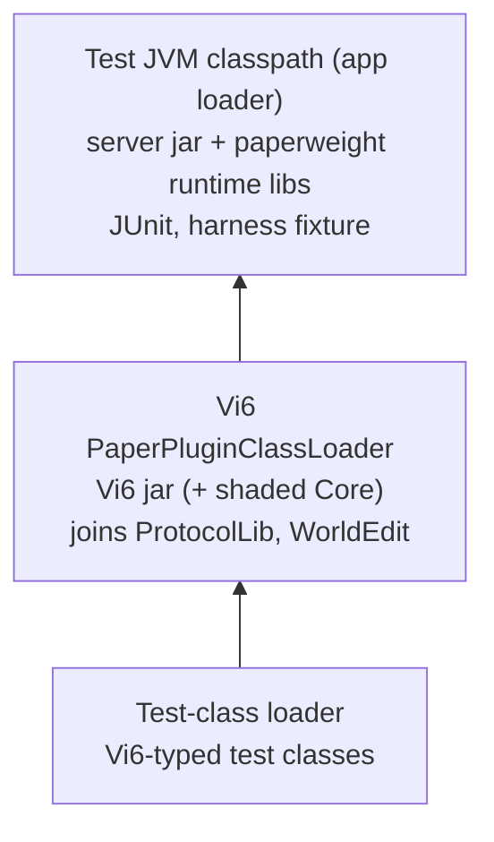

# Harness design

The mechanism the 2026-10-29 spike verified, now built in paper-junit-server. This is the reference for how CAP-2 to CAP-5 are built; the kernel holds the what.

## Where the code lives

- **paper-junit-server** (`fr.xxgoldenbluexx.paperjunitserver`; standalone library in its own repository; consumers add it as a git submodule plus `includeBuild`, like NekotineCore; in Vi6 the submodule sits at `paper-junit-server/`, next to `NekotineCore/`): the fixture (boot, `onMain`, waits, stop), the `LauncherSessionListener`, the no-exit agent, and the shared Gradle wiring (bundle staging, `integrationTest` suite, agent attachment). It may use paperweight directly. Consumers take it on test configurations only.
- **Vi6:** game hooks (force map, teams, phase; reset; short-timer config) and the Vi6-typed tests. NekotineBots: its host plugin and tests.
- NekotineCore is not involved, apart from the relocation change on the Vi6 side.

## Classloaders

- Test-JVM classpath: `mappedServerJar` plus paperweight's `mojangMappedServerRuntime`, JUnit, and the harness fixture (boot, `onMain`, waits). Nothing else.
- Vi6-typed test classes live in a source set that is compiled against `main` but is **never** on the test runtime classpath. They are only passed to the `Test` task as `testClassesDirs`.
- A `LauncherSessionListener` (registered in `META-INF/services`) boots the server in `launcherSessionOpened`. It then sets the thread context classloader to a `URLClassLoader` over those classes, whose parent is Vi6's plugin classloader. Gradle 9.4's `JUnitPlatformTestDefinitionProcessor` opens the session before it reads the TCCL, then loads each test class with `Class.forName(name, false, tccl)`, so discovery and reports are native. If a Gradle upgrade breaks the swap, start there. The listener acts only when a system property is set, so other suites are unaffected. The plugin whose classloader becomes the parent is the `targetPlugin` setting (Vi6Clean, or NekotineBots' host plugin).
- Not needed: the `vi6-testapi` module published through `ServicesManager`.

## Boot

- The consumer sets the bundle path in its build (`paperJunitServer { bundle = ... }`), and there is no default bundle. A missing or non-directory bundle fails the run loudly. Gradle stages the bundle with a `Sync` task into `build/it-server/`. It copies only what the server needs, adds the Vi6 jar to `plugins/`, and rewrites `server.properties`: rcon off, free port. Staging happens in Gradle, not in JUnit, because the worker's `workingDir` must exist before the JVM starts.
- The fixture calls `org.bukkit.craftbukkit.Main.main({"--nogui"})` on a daemon thread and waits until `Bukkit.getCurrentTick() > 0`. If the launcher thread dies, it fails at once with the cause.
- JVM properties: `terminal.jline=false`, `terminal.ansi=false`, `com.mojang.eula.agree=true`; heap 3 GB.
- `onMain` is `callSyncMethod(...).get(timeout)`. `awaitTicks` and `awaitUntil` poll on the main thread with a tick deadline.

## Stop

- `DedicatedServer.onServerExit` ends with `System.exit(abnormalExit ? 70 : 0)`. It is called from `MinecraftServer.stopServer()`, and no flag skips it. JEP 486 removed the SecurityManager and offers no veto API.
- Other `System.exit` calls are not patched: `ServerWatchdog`, `RestartCommand` and the bootstrap `Main`. A test that blocks the main thread for about a minute trips the watchdog, which kills the test JVM and loses the reports.
- Rejected bypasses, if the agent needs replacing:
  - A SecurityManager `checkExit`: gone since JDK 24.
  - An agent on `java.lang.Runtime.exit`: catches every caller, but needs bootstrap retransformation and Byte Buddy.
  - `junit5-system-exit`: turns every exit into an exception; it's built for asserting exit codes.
  - Subclassing `DedicatedServer`: its construction sits in a lambda in `net.minecraft.server.Main.main`, which would have to be copied every Paper release.
- **Primary:** a `-javaagent` (`java.lang.classfile`, ~40 lines) that removes that one call. The agent records whether it patched anything, and the harness fails the run if it did not. After `Bukkit.shutdown()` the harness joins the server thread (spike: 0.6–1.6 s) and fails if the thread is missing or still alive.
- **Fallback, no agent:** a shutdown hook registered before `Bukkit.shutdown()`. It holds JVM shutdown open until Gradle's worker thread is itself inside `java.lang.Shutdown`, which means reporting is done. It is verified on `integrationTest` only, depends on Gradle internals, and server logging stops at exit.
  - The process exit code is the server's, so an abnormal stop (70) fails the Gradle task.
  - Release the hook once the worker is inside `java.lang.Shutdown`. Waiting for the worker thread to *end* deadlocks, because the worker blocks behind the hook; the spike hit a 2-minute timeout that way.

## Build wiring

- `integrationTest` is a `JvmTestSuite` (JUnit Jupiter) that `build` and `check` don't depend on.
- `shadowJar`: no `fr.nekotine.core` relocation; `relocate("dev.jorel.commandapi", "fr.nekotine.core.commandapi")`.
- Lock new configurations only, and review the lockfile diff.
- Never run bare `gradlew` while testing: its `out` task copies the jar into the dev server's `plugins/update` and restarts that server.

## Plan B: JUnit launched from a test-host plugin

Not built. Switch to it if the in-process design breaks after a Paper or Gradle upgrade. Two signs: the agent self-check fails because `onServerExit` was renamed or no longer calls `System.exit`, or Gradle stops loading test classes through the context classloader the session listener sets.

- **Shape:**
  - A test-host plugin, separate from the plugin under test so JUnit never ships in production, depends on that plugin and bundles JUnit and the compiled tests.
  - Once the server is up, it runs the JUnit Platform `Launcher` on its own thread (not the main thread) and writes XML reports with the platform's reporting listener, then calls `Bukkit.shutdown()`.
  - Gradle starts the staged server as a child process (`JavaExec`) and fails the build if the reports show failures.
- **Gains:** test classes load through a plugin classloader the normal way, so there's no context-classloader swap and no dependence on Gradle internals. Paper's `System.exit` is just the end of the server process, so there's no no-exit agent. Any server works, even a full copy of production.
- **Losses:**
  - No native Gradle test integration: no per-test console output, and no `--tests` filter unless the plugin is passed the filters.
  - No "run this test" from the IDE.
  - A second jar to build and stage on every run.
  - The debugger attaches to a separate server process.
- **Unchanged:** `onMain` is still needed, because tests can't block the main thread and still wait in ticks. The server is booted once, before any test, so `@BeforeAll`/`@AfterAll` still manage game state only.
- **Pitfall:** a `Jar` task built from `provider { zipTree(filteredConfiguration) }` can stay UP-TO-DATE with stale content after the filter changes. Use real task inputs for the test-host jar (and for NekotineBots' host plugin).
- **Cost:** a rework of the harness (fixture, Gradle plugin) and of story 2's wiring. Go through the spec first.

## Known noise and bugs

- Harmless on Windows: FAWE's LZ4 binding error and history warnings; OSHI registry and perf-counter errors.
- Pre-existing: Vi6 `onDisable` throws an NPE when `plugins/update/` is missing (`UpdateFolderRestart` never started). It is tracked in `_bmad-output/implementation-artifacts/deferred-work.md`. Staging can create the folder, but note that `UpdateFolderRestart` would then watch it.
